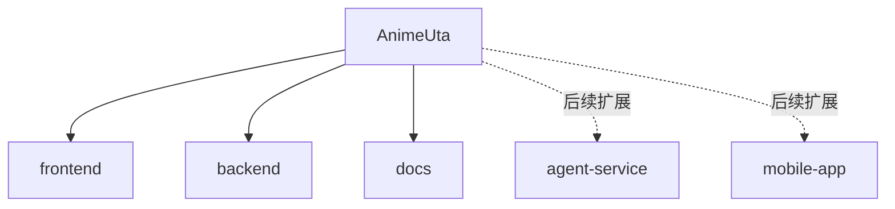

# CLAUDE.md

## 项目愿景
- AnimeUta 是一个以 ACG 歌曲为核心的音乐软件，目标支持日语、中文、英语三语。
- 当前第一阶段优先建设 Web 端，后续再扩展 Android React Native。
- 产品初期定位为“ACG 音乐播放器 + 资料信息增强”，先保证可播放、可搜索、可收藏，再逐步增强作品维度与 Agent 能力。

## 已确认技术选型
### 前端
- 技术栈：React + Vite + TypeScript
- 路由：React Router
- 全局状态：Zustand
- 服务端数据请求：TanStack Query
- 国际化：i18next
- 样式：Tailwind CSS

### 后端
- 技术栈：Java + Spring Boot
- 数据访问：MyBatis-Plus
- 数据库：PostgreSQL
- API 风格：RESTful
- 建议补充：Spring Security + JWT、OpenAPI / Swagger

### AI / Agent
- 第一阶段只预留能力边界，不要求先落地复杂多 Agent。
- 推荐先做垂直能力：
  - 元数据补全
  - 自然语言转搜索条件
  - 歌曲 / 作品简介生成
- 推荐采用独立 `agent-service/` 的方式，而不是一开始就把所有 Agent 逻辑塞进 Java 主服务。

## 当前阶段目标
- 先搭建项目骨架，而不是一次性实现完整产品。
- 第一版只做 MVP：
  - 首页
  - 搜索页
  - 歌曲详情页
  - 登录页
  - 收藏页
  - 全局播放器
  - 三语切换
  - 基础用户系统
  - 歌曲 / 艺人 / 作品 / 专辑基础数据能力

## 规划中的目录结构


```text
AnimeUta/
  frontend/       # React Web 用户端
  backend/        # Java Spring Boot 服务端
  docs/           # 设计文档、接口说明、原型记录
  agent-service/  # 后续 AI/Agent 服务
  mobile-app/     # 后续 React Native Android 端
```

## 模块索引
| 模块路径 | 技术栈 | 职责 | 当前状态 |
|---|---|---|---|
| `frontend/` | React + TS | Web 用户端，页面、播放器、搜索、多语言 | 规划中 |
| `backend/` | Spring Boot + MyBatis-Plus | 用户、曲库、搜索、收藏、歌单、鉴权 API | 规划中 |
| `docs/` | Markdown | 设计文档、数据模型、接口说明 | 规划中 |
| `agent-service/` | 待定 | Agent / RAG / 自然语言搜索等 AI 能力 | 后续扩展 |
| `mobile-app/` | React Native | Android 客户端 | 后续扩展 |

## 前端页面规划
### 第一版页面
- `/`：首页
- `/search`：搜索页
- `/song/:id`：歌曲详情页
- `/login`：登录页
- `/favorites`：收藏页
- 全局底部播放器：全站共享

### 前端职责边界
- React 负责页面与组件组织
- Router 负责页面跳转
- Zustand 负责播放器、用户语言、登录态等共享状态
- TanStack Query 负责请求后端歌曲、搜索、收藏等数据
- i18next 负责 UI 文案中日英切换

## 后端模块规划
建议至少拆为以下业务模块：
- `auth`：登录注册、鉴权
- `user`：用户资料
- `music`：歌曲、艺人、专辑
- `work`：动画 / 游戏作品信息
- `playlist`：歌单
- `favorite`：收藏
- `search`：搜索
- `i18n`：多语言内容支持
- `agent`：AI 能力入口（后续）

## 数据模型方向
第一版核心实体建议：
- `song`
- `artist`
- `work`
- `album`
- `user`
- `playlist`
- `user_favorite_song`
- `play_history`
- `song_artist`
- `song_work`

多语言字段第一阶段优先采用直列方案：
- `title_ja`
- `title_zh`
- `title_en`
- 可选 `title_romaji`

## 搜索策略
- 第一阶段优先使用 PostgreSQL 搜索能力完成：
  - `ILIKE`
  - Full Text Search
  - trigram 模糊匹配
- 搜索对象至少覆盖：
  - 歌曲名
  - 艺人名
  - 作品名
  - 别名
  - 罗马音
- 数据规模增大后，再考虑 Meilisearch / Elasticsearch。

## 开发顺序
1. 建立仓库目录结构
2. 设计数据库表结构
3. 设计前端页面结构
4. 设计后端 API 清单
5. 搭建前后端骨架
6. 先打通“首页列表 → 歌曲详情 → 播放”闭环
7. 再补登录、收藏、歌单、搜索、多语言
8. 最后再接 Agent 能力

## AI 使用指引
- 当前 `CLAUDE.md` 以“已确认方案”作为基线，而不是基于现有源码扫描出的真实模块。
- 后续一旦创建 `frontend/`、`backend/`、`docs/` 等目录，应补充模块级 `CLAUDE.md`。
- 生成代码前，应优先围绕以下问题检索：
  1. 是否已有可复用实现
  2. 会影响哪些调用链
  3. 当前任务属于 MVP 还是后续扩展
- 前端讲解默认面向零基础，采用“边做边学”的解释方式。

## 当前仓库状态
- 当前仓库仍处于项目规划期，尚未创建实际业务目录和源码文件。
- 当前根目录仅有：
  - `CLAUDE.md`
  - `.claude/`
  - `.git/`
- 因此本文件主要承担“项目初始化蓝图”作用。

## 变更记录 (Changelog)
- 2026-04-03 12:06:06：首次空仓初始化，仅建立扫描基线。
- 2026-04-03 12:55:06：根据已确认方案重写初始化文档，明确 React Web + Java + PostgreSQL + MyBatis-Plus + 后续 Agent / RN 扩展路线。

## .context 项目上下文

> 项目使用 `.context/` 管理开发决策上下文。

- 编码规范：`.context/prefs/coding-style.md`
- 工作流规则：`.context/prefs/workflow.md`
- 决策历史：`.context/history/commits.md`

**规则**：修改代码前必读 prefs/，做决策时按 workflow.md 规则记录日志。
